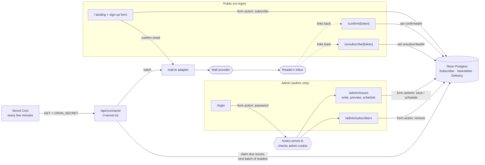
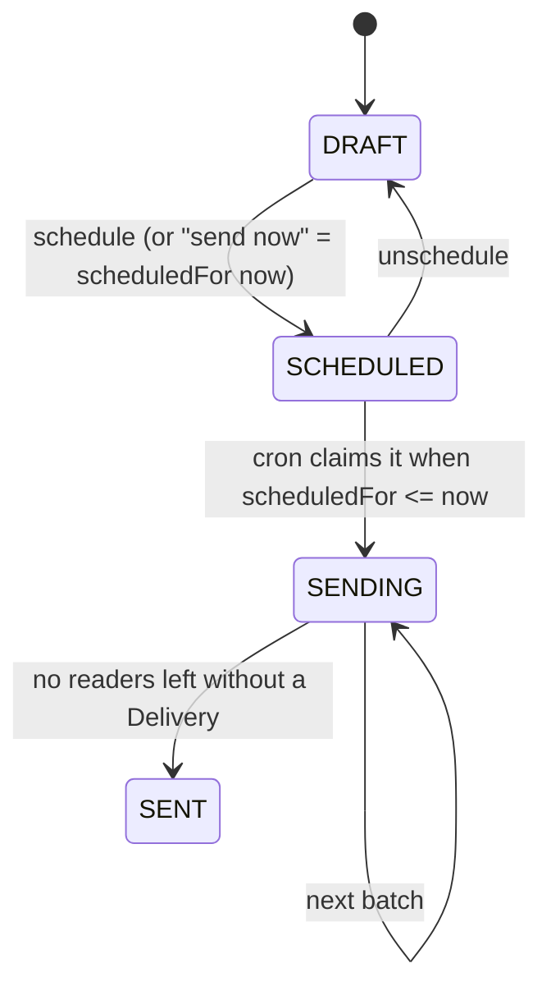

# Architecture

How the newsletter app is put together, and why. One author writes issues in a private admin area. Readers subscribe on a public page and receive the issues by email. See `PRODUCT.md` for the product and `DESIGN.md` for the look.

Status: the database, Vercel adapter and landing page exist. Everything else here is the agreed plan. Parts marked _planned_ are not built yet.

## Stack

| Layer     | Choice                                                   | Why                                                                                                    |
| --------- | -------------------------------------------------------- | ------------------------------------------------------------------------------------------------------ |
| Framework | SvelteKit + Svelte 5 runes                               | Pages, server code and form handling in one place; works without client JS                             |
| Hosting   | Vercel (`@sveltejs/adapter-vercel`)                      | Zero-config SvelteKit deploys, plus Vercel Cron for scheduled sending                                  |
| Database  | Postgres on Neon, via Prisma                             | Serverless Postgres that suits short-lived Vercel functions; Prisma gives typed queries and migrations |
| Mail      | Undecided, behind an adapter in `src/lib/server/mail.ts` | Keeps the provider swappable; nothing outside that file knows which one is used                        |
| Styling   | Tailwind v4 with tokens from `DESIGN.md`                 | One source of truth for color and type                                                                 |

## Data flow

All database and mail access lives in `src/lib/server/`, so it can never be bundled into the browser. Pages call it only from `+page.server.ts` load functions and actions, or from `+server.ts` endpoints.

## Routes

| Route                  | Files                             | Purpose                                                      |
| ---------------------- | --------------------------------- | ------------------------------------------------------------ |
| `/`                    | `+page.svelte`, `+page.server.ts` | Landing page and sign-up form (`subscribe` action)           |
| `/confirm/[token]`     | `+page.server.ts`                 | Double opt-in: marks the subscriber confirmed                |
| `/unsubscribe/[token]` | `+page.server.ts`                 | One-click unsubscribe from the email footer                  |
| `/login`               | `+page.server.ts`                 | Password form, sets the admin cookie                         |
| `/admin/issues`        | list, `new`, `[id]`               | Write in Markdown, preview, save draft, schedule or send now |
| `/admin/subscribers`   | `+page.server.ts`                 | List, search and remove subscribers                          |
| `/api/cron/send`       | `+server.ts`                      | Called by Vercel Cron; sends due issues in batches           |

**Why form actions:** every write (subscribing, logging in, saving, scheduling, removing) is a SvelteKit form action, enhanced with `use:enhance`. The forms work without JavaScript, validation happens on the server, and there is no separate API to keep in sync. The only `+server.ts` endpoint is the cron one, because no browser calls it.

## Login

There is one user, the author. They log in with a password from the `ADMIN_PASSWORD` env var.

1. The `/login` action compares the submitted password with `ADMIN_PASSWORD` using a constant-time comparison.
2. On a match, it sets an `httpOnly`, `secure`, `sameSite=lax` cookie whose value is signed with `SESSION_SECRET`.
3. `hooks.server.ts` checks the signature on every `/admin/*` request and redirects to `/login` when it's missing or invalid.
4. Logout clears the cookie. Changing `SESSION_SECRET` logs out every session.

**Why:** a single-author tool doesn't need user accounts, password resets or an auth library. The trade-off is that adding a second author later means replacing this with real accounts. The guard sits in the hook, not in each page, so a new admin page can't be added without protection by accident.

## Sign-up (double opt-in)

1. The reader submits their email. The `subscribe` action creates a `Subscriber` with `confirmedAt = null` and emails them a `/confirm/[token]` link.
2. Clicking the link sets `confirmedAt`. Only confirmed subscribers who haven't unsubscribed receive issues.
3. If the address is already subscribed, the action shows the same "check your inbox" message. That way the form doesn't reveal who is on the list.

**Why:** it stops typos and people signing up someone else's address, and it's what GDPR expects. This follows the "respect the list" principle in `PRODUCT.md`.

## Sending

1. Vercel Cron calls `/api/cron/send` every few minutes. The endpoint rejects any request without the `CRON_SECRET` header.
2. It moves due issues from `SCHEDULED` to `SENDING` in a single conditional update. If two runs overlap, only one of them claims the issue.
3. For each `SENDING` issue, it picks the next batch of confirmed subscribers who have no `Delivery` row for that issue yet. It renders the Markdown to email-safe HTML, adds each reader's unsubscribe link, sends the batch through `mail.ts`, and records a `Delivery` row for each reader.
4. When no readers are left, the issue becomes `SENT` and `sentAt` is set.

**Why cron and batches:** sending from the button's form action would hit Vercel's function time limit on a large list, and it couldn't do scheduling. A run that crashes partway loses nothing, because the next run picks up from the `Delivery` rows and nobody gets the issue twice.

**Safety:** outside production, `mail.ts` logs instead of sending, or sends only to an allow-listed test address, so development never emails real readers (an `AGENTS.md` rule).

## Data model

Already in `prisma/schema.prisma`: `Subscriber` (email, unsubscribe token, unsubscribe date) and `Newsletter` (subject, Markdown body, status, schedule).

_Planned_ additions:

- `Subscriber.confirmedAt DateTime?` and `Subscriber.confirmToken String @unique`, for double opt-in.
- `Delivery { newsletterId, subscriberId, sentAt }` with `@@unique([newsletterId, subscriberId])`. It records who has received which issue, so batches can resume and nobody gets an issue twice.

No session table is needed: the signed cookie carries the admin session.

## Configuration

Secrets are declared in `src/env.ts` and read through `$app/env/private`, only in `src/lib/server/` or `+*.server.ts` files.

| Variable         | Used by                              |
| ---------------- | ------------------------------------ |
| `DATABASE_URL`   | `src/lib/server/db.ts` (exists)      |
| `ADMIN_PASSWORD` | `/login` action                      |
| `SESSION_SECRET` | signing the admin cookie             |
| `CRON_SECRET`    | `/api/cron/send`                     |
| `MAIL_*`         | `mail.ts`, once a provider is chosen |

## Open decisions

- Mail provider. The `mail.ts` adapter interface is `sendBatch(messages)`, which every major provider supports.
- Batch size and cron interval. Both depend on the provider's rate limits.
- Bounce and complaint handling. A provider webhook should mark the address unsubscribed, but it's not designed yet.
